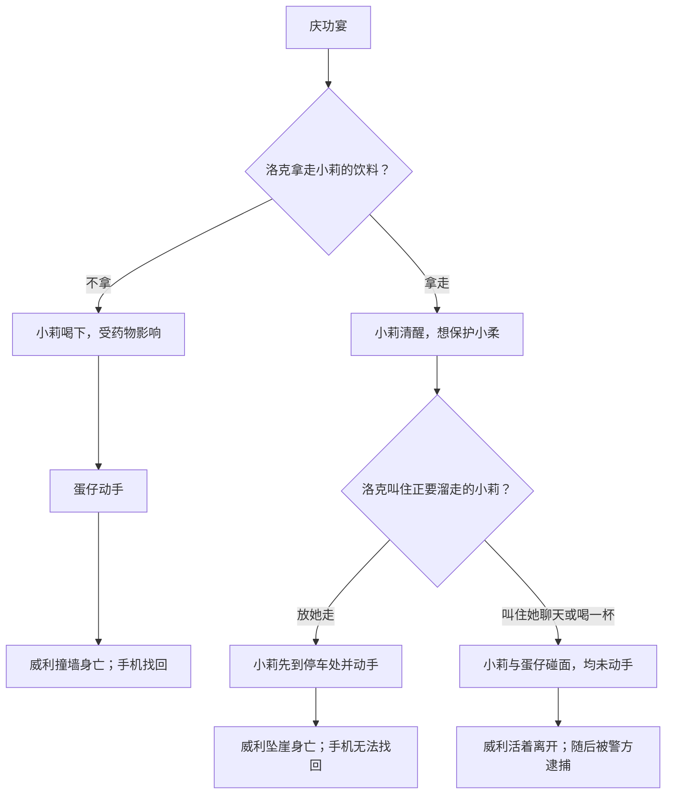

# 昨夜剧情树

创作草案 · 含剧透 · 2026-11-23

[查看图示](plot-tree.svg) · [现有主线整理](current-storyline.md)

## 现有主线

醒来 → 发现亚瑟 → 寻人救援 → 调查举证 → 蛋仔被捕 → 尾声。

## 新增：庆功宴中的选择

## 屏蔽器：独立分支

谁偷走？谁开启、藏起？相关选择待设计，**不由车辆分支决定**。

## 后续衔接

- 小莉知道威利伤害小柔，动机是保护小柔。
- 亚瑟案暂沿用蛋仔、枕头和黑羽线索。
- 小莉未被下药时，重写发现她的场景与证词。
- 坠崖线不出现威利手机里的证据；生还线增加威利的证词。
- 待补：洛克昏睡前的时间衔接、独立的屏蔽器选择，以及各线的具体时间表。

仅整理剧情，尚未改动游戏代码。
