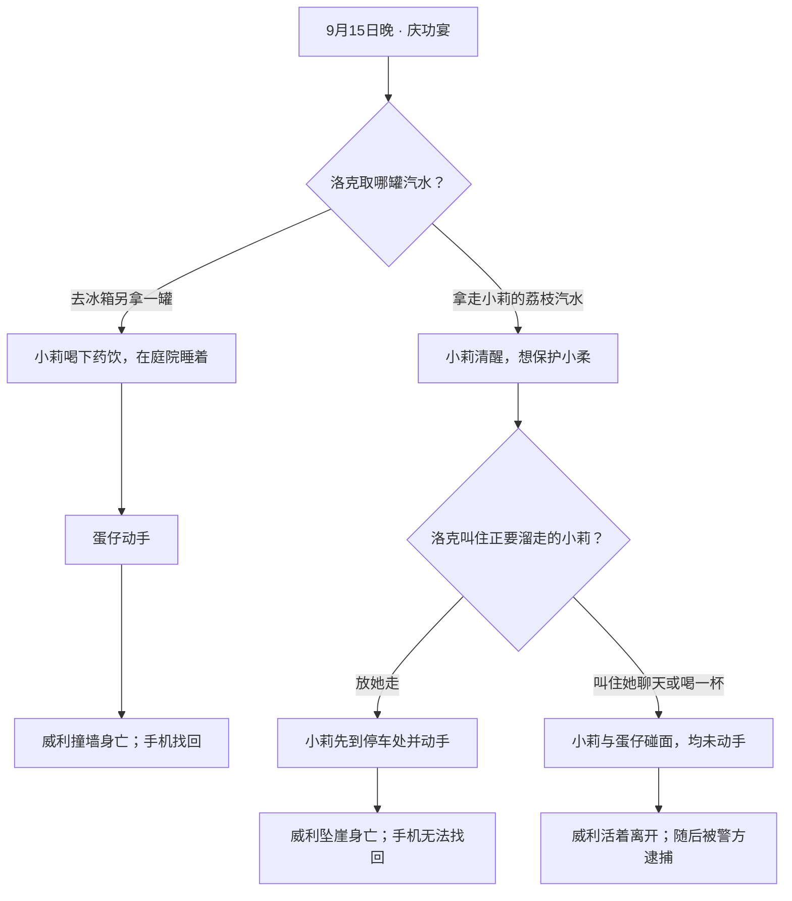

# 昨夜剧情树

创作草案 · 含剧透 · 更新于 2026-11-27

[查看图示](plot-tree.svg) · [现有主线整理](current-storyline.md)

## 现有主线

醒来 → 发现亚瑟 → 寻人救援 → 调查举证 → 蛋仔被捕 → 尾声。

## 新增：庆功宴中的选择

9 月 15 日下午至傍晚演出，15 日晚至 16 日凌晨案发，16 日洛克醒来。第一次选择的中英文台词与衔接见[场景稿](last-night-first-choice.md)。

## 屏蔽器：独立分支

谁偷走？谁开启、藏起？相关选择待设计，**不由车辆分支决定**。

## 后续衔接

- 小莉知道威利伤害小柔，动机是保护小柔。
- 亚瑟案暂沿用蛋仔、枕头和黑羽线索。
- 小莉未被下药时，重写发现她的场景与证词。
- 坠崖线不出现威利手机里的证据；生还线增加威利的证词。
- 待补：洛克昏睡前的时间衔接、独立的屏蔽器选择，以及各线的具体时间表。

汽水选择与对应对话已接入游戏；玩家路线图和创作画布均已画出两个分支。拿走小莉的饮料后暂止于庆功宴；冰箱选项接回原路线。图中的车辆与屏蔽器新分支仍是创作草案。
